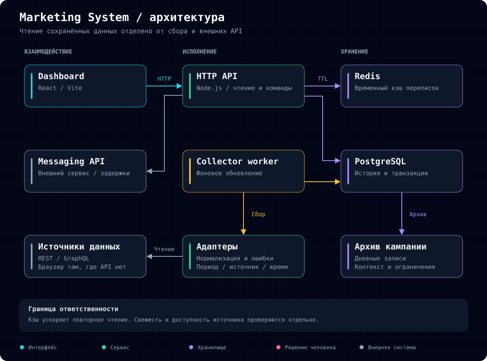
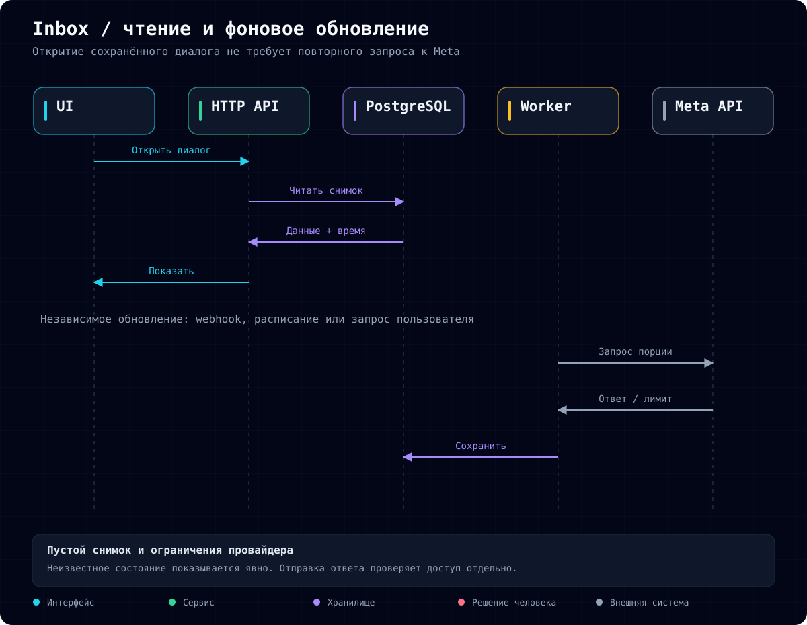

# Marketing System

English · [Русский](README.md)

**A unified workspace for marketing data, campaigns and customer conversations.**

I develop an internal application that helps a business owner review promotion results and handle conversations without constantly switching between services. The focus is reliable metrics, access to saved data and controlled background collection.

This is a public engineering case study. Production source code, customer data and integration credentials remain private.

## Business context

Campaign data is distributed across advertising platforms, web analytics, email tools, social networks and a sales platform. Evaluating results requires reconciling periods, checking freshness and deciding whether the evidence supports an attribution claim.

This complicates daily decisions and campaign reviews. A collection failure can look like missing sales, while a click followed by a purchase can be mistaken for proven advertising impact.

**Objective:** bring operational context together, preserve metric provenance and reduce dependence on external API latency during everyday work.

## Changes delivered

| Problem | Engineering response | Operational value |
| --- | --- | --- |
| Fragmented reporting | Dashboard and source adapters | One workspace for reviewing metrics |
| Unclear freshness | Observation time, reporting period and source status | Visible data limitations |
| Missing data interpreted as zero | Explicit unknown and error states | Collection failures do not become business conclusions |
| Opening conversations waits for an API | Persisted messages and background refresh | Loaded messages remain readable without another Meta request |
| Retries and provider limits | Transactions, deduplication and shared cooldown | Controlled repeated collection |
| Campaign knowledge stays fragmented | Historical archive with context | Evidence for reviewing future launches |

## Architecture

The React UI calls a Node.js API. PostgreSQL stores business history and the latest conversation snapshots. A separate worker refreshes source data. Docker Compose provides local deployment.

Meta webhooks trigger refreshes ahead of the next visit. The public receiver is separate from the private application interface. Events are validated before processing; receiving an event does not authorize sending a reply.

## Evolving the inbox design

The first implementation waited for Meta when opening a conversation. Redis improved repeat reads, but cold requests and expired entries still depended on the provider. Snapshots were then moved to PostgreSQL and refreshes moved into background processing. This reduced infrastructure components and preserved loaded messages across restarts.

Bulk preloading exposed another constraint: provider rate limits. Collection now uses small batches and a shared cooldown after throttling. Saved conversations remain available. Complete preloading of all historical conversations is not claimed.

## Results and validation

The application combines analytics, campaign history and conversations, with persistence, background updates and explicit integration failures. Time savings and revenue impact have not yet been measured.

In one local verification, HTTP reads for seven database-backed sections took **3–48 ms**. This is a scenario-specific observation, not an SLA or load-test result. Unit and PostgreSQL integration tests cover persistence, access revocation, duplicate work and provider limits.

Payment events, confirmed pledges and advertising conversions remain distinct concepts. Temporal proximity alone is not treated as attribution.

## My contribution and decisions

I own workflow definition, metric semantics, integration and storage decisions, operational verification and interface development. Implementation is AI-assisted; design choices and acceptance of results remain my responsibility.

- **Consolidated PostgreSQL storage:** fewer components for a single-owner tool, with transactions and historical records.
- **Background refresh:** access to saved data, with freshness shown explicitly.
- **Local deployment:** proportionate infrastructure, with availability tied to the workstation.
- **Historical evidence before forecasting:** comparable observations before evaluating predictive models.

**Stack:** React, JavaScript, Node.js, PostgreSQL, Docker Compose, REST/GraphQL and webhooks. Redis was used in an earlier iteration.

[Diagram assets](docs/diagrams/) · [Developer profile](https://github.com/RassolovSergey)
