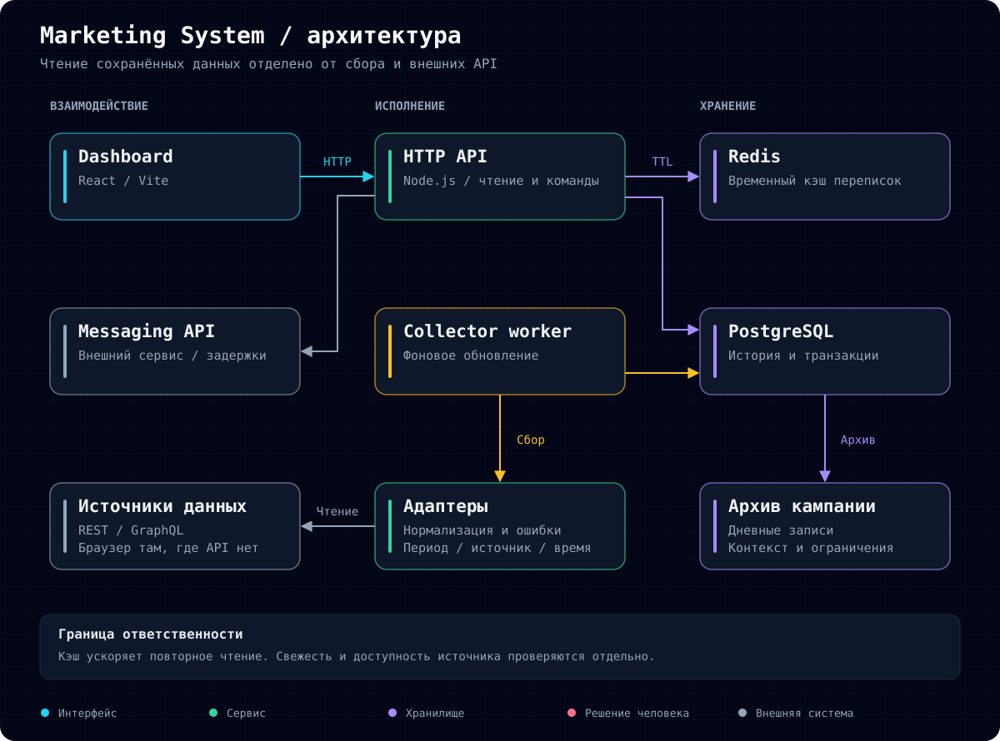
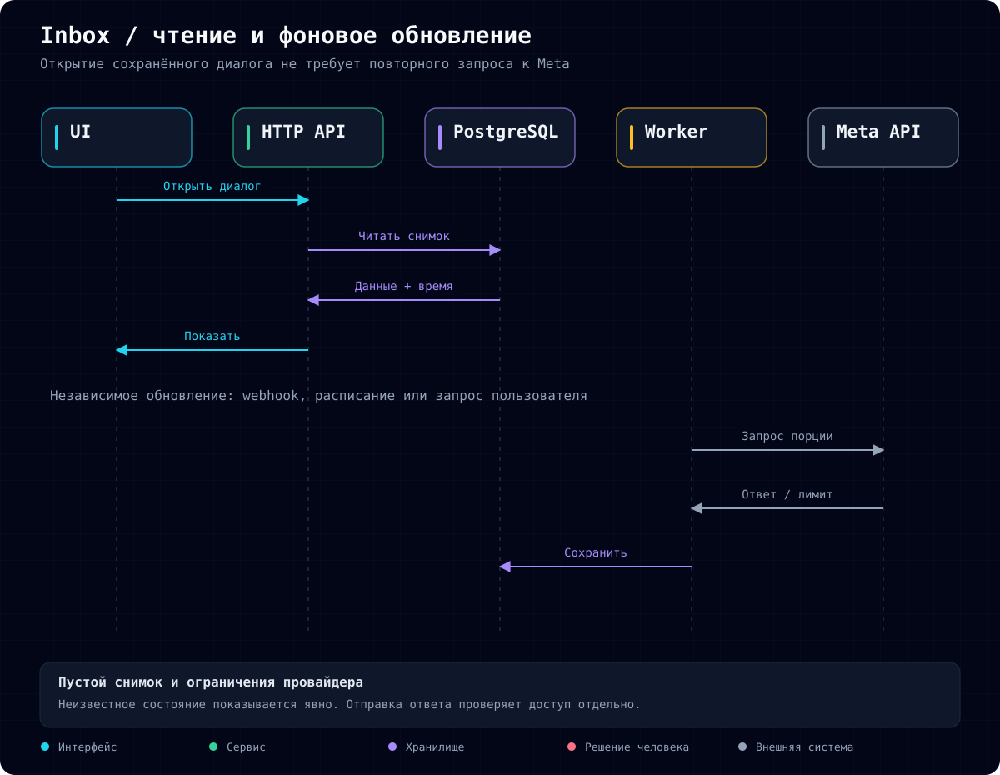

# Marketing System

Русский · [English](README.en.md)

**Единое рабочее пространство для маркетинговых данных, кампаний и переписок.**

Развиваю внутреннее приложение, которое помогает владельцу бизнеса оценивать продвижение и работать с сообщениями без постоянного переключения между сервисами. Основной фокус: достоверность показателей, доступность сохранённых данных и управляемый фоновый сбор.

Это публичный кейс разработки. Рабочий код, клиентские данные и настройки интеграций закрыты.

## Бизнес-задача

Данные кампании распределены между рекламным кабинетом, веб-аналитикой, рассылками, социальными сетями и площадкой продаж. Для оценки результата приходится сопоставлять периоды, проверять свежесть и определять, достаточно ли данных для вывода о влиянии рекламы.

Это затрудняет ежедневные решения и разбор завершённой кампании. Сбой интеграции может выглядеть как отсутствие продаж, а совпадение клика и покупки по времени легко принять за доказанную конверсию.

**Цель системы:** собрать рабочий контекст в одном месте, сохранить происхождение показателей и уменьшить зависимость повседневных операций от скорости внешних API.

## Что изменили

| Проблема | Решение | Практический результат |
| --- | --- | --- |
| Разрозненные кабинеты | Dashboard и адаптеры источников | Показатели в одном рабочем пространстве |
| Непонятная свежесть | Время наблюдения, период и состояние источника | Видимые ограничения данных |
| Пропуск воспринимается как ноль | Отдельные состояния неизвестного значения и ошибки | Сбой сбора не превращается в бизнес-вывод |
| Открытие диалога ждёт API | Сохранённые переписки и фоновое обновление | Уже загруженные сообщения доступны без нового запроса к Meta |
| Повторы и ограничения API | Транзакции, дедупликация и общая пауза после rate limit | Контролируемые повторные загрузки |
| Опыт кампании остаётся в разных сервисах | Архив показателей и контекста | База для сравнения будущих запусков |

## Архитектура

React-интерфейс обращается к Node.js API. PostgreSQL хранит бизнес-историю и последние загруженные переписки. Отдельный worker обновляет данные через адаптеры источников. Docker Compose обеспечивает локальный запуск.

Meta webhooks запускают обновление заранее. Публичная точка приёма отделена от приватного интерфейса. Входящие события проверяются перед обработкой; получение события не даёт права отправлять ответ.

## Эволюция работы с переписками

Первоначально открытие диалога зависело от ответа Meta. Redis ускорил повторное чтение, но первый запрос и истёкший кэш всё ещё требовали ожидания. Затем снимки переписок перенесли в PostgreSQL, а обновление вынесли в фон. Это уменьшило число компонентов и сохранило загруженные сообщения между перезапусками.

Массовая предварительная загрузка выявила другую границу: rate limit провайдера. Теперь сбор идёт небольшими порциями, а после ограничения действует общая пауза. Сохранённые диалоги остаются доступны. Полная предварительная загрузка всей истории не заявляется.

## Результат и проверка

Система объединяет аналитику, историю кампаний и переписки. Реализованы сохранение данных, фоновые обновления и обработка сбоев интеграций. Экономия рабочего времени и влияние на выручку пока не измерены.

В локальной проверке HTTP-чтение семи разделов из базы занимало **3–48 мс**. Это конкретный сценарий, не SLA и не нагрузочный тест. Unit-тесты и PostgreSQL integration tests проверяют сохранность снимков, отзыв доступа, повторы и ограничения API.

События оплаты, подтверждённые взносы и рекламные конверсии имеют разные определения. Система не приписывает продажу рекламе только по совпадению времени.

## Моя роль и принятые решения

Формулирую продуктовые сценарии, определяю смысл метрик, проектирую интеграции и хранение, проверяю рабочие процессы и развиваю интерфейс. Разработка AI-assisted; выбор решений и проверка результата остаются моей ответственностью.

- **PostgreSQL вместо нескольких хранилищ:** проще сопровождать личный инструмент, сохраняя транзакции и историю.
- **Фоновое обновление:** интерфейс читает полученные данные; свежесть показывается явно.
- **Локальный запуск:** соответствует масштабу одного владельца, но зависит от рабочего компьютера.
- **Архив перед прогнозированием:** сначала сопоставимые данные, затем оценка прогнозных моделей.

**Стек:** React, JavaScript, Node.js, PostgreSQL, Docker Compose, REST/GraphQL, webhooks. Redis использовался в предыдущей итерации.

[Схемы и исходники](docs/diagrams/) · [Профиль разработчика](https://github.com/RassolovSergey)
