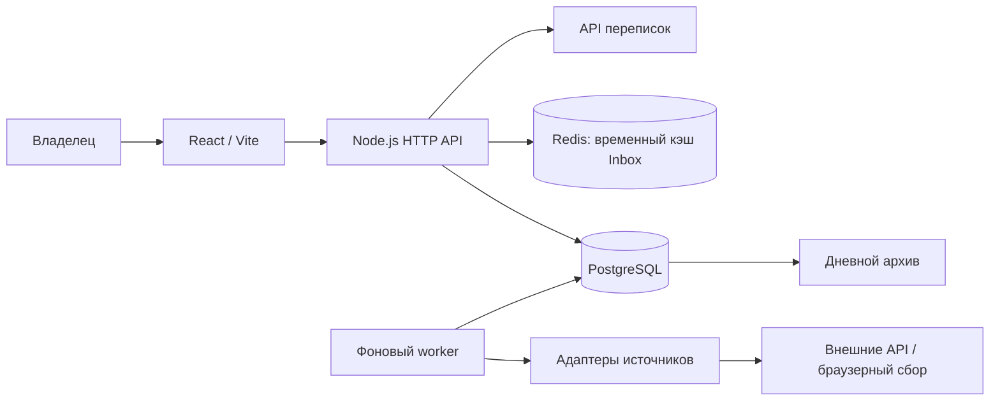
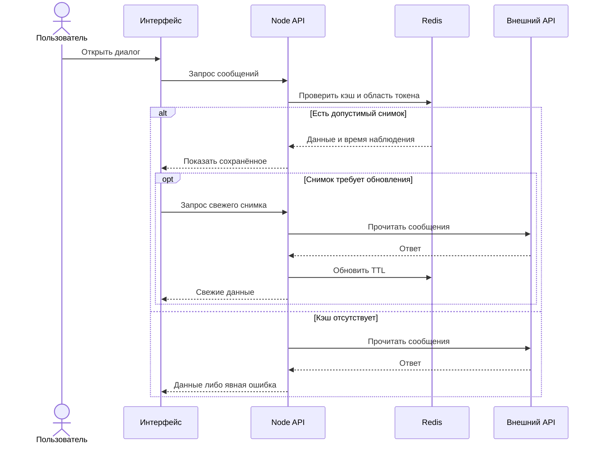

# Marketing System

### Инженерный кейс: достоверная аналитика поверх ненадёжных внешних API

**Backend engineering · Data ingestion · PostgreSQL · Redis · React · Observability**

Маркетинговый dashboard полезен только тогда, когда пользователь понимает, что именно означает показанное число. В этом проекте основной инженерной задачей стала согласованность данных: разные временные зоны, задержки API, накопительные счётчики, недоступные разрешения и повторные попытки сбора.

Я проектирую и развиваю внутреннее приложение, которое объединяет данные кампаний и помогает отличать изменение бизнеса от сбоя измерения. Рабочий код и реальные аккаунты остаются закрытыми. Здесь опубликован технический кейс, а не готовая open-source поставка.

## Задача и декомпозиция

Исходный сценарий предполагает переключение между рекламным кабинетом, веб-аналитикой, рассылками и страницей кампании. Ручное сопоставление чисел не сохраняет ни происхождение вывода, ни точный период. Даже корректные показатели могут противоречить друг другу: события оплаты, число участников и полученные деньги имеют разную семантику.

| Риск исходного процесса | Реализованное решение | Что получает пользователь |
| --- | --- | --- |
| Свежесть приходится проверять в каждом кабинете | Время наблюдения, последнего чтения и состояние сборщика | Видимое устаревание данных |
| Ошибка API выглядит как нулевой результат | Неизвестные значения отделены от нулевых | Отсутствие выдуманных провалов |
| Повторная загрузка может удвоить показатели | Ключи записей, транзакции и повторяемый импорт | Повтор сбора без суммирования копий |
| Внешний API задерживает работу экрана | Отдельный worker и чтение сохранённых данных | Интерфейс не запускает все интеграции заново |
| Переписка повторно загружается при открытии | Краткоживущий Redis-кэш и обновление свежих данных | Быстрое повторное чтение |
| История кампании теряется между кабинетами | Дневной архив с контекстом и оговорками | Материал для последующего анализа |

Это описание устранённых классов проблем, а не утверждение о проведённом контролируемом исследовании производительности бизнеса.

## Архитектура и границы ответственности

Docker Compose запускает web, worker, PostgreSQL и Redis. Бизнес-история хранится в PostgreSQL; кэш переписок не является её заменой. Браузерный сбор применяется там, где нет подходящего доступного API, и остаётся источником с отдельными рисками блокировки и полноты.

### Последовательность чтения переписки

Важная граница: кэш ускоряет чтение, но не выдаёт разрешения на отправку. Проверка доступа и допустимости ответа выполняется отдельным путём. Webhooks пока не объявляются работающей интеграцией.

## Решения и цена компромисса

- **PostgreSQL и транзакции.** Повторные загрузки, конкурентные задачи и откат требуют проверяемого поведения. Используются ограничения данных и advisory locks. Плата за это: миграции и необходимость проверять восстановление резервной копии.
- **Redis с TTL.** Уменьшает задержку повторного чтения. После истечения кэша первый запрос всё ещё зависит от внешнего API; кэш не исправляет просроченный токен.
- **Отдельный процесс сбора.** Убирает загрузку источников из пользовательского запроса. Нужны контроль состояния worker и явное отображение свежести.
- **Локальный запуск.** Соответствует личному инструменту с закрытыми аккаунтами. Доступность ограничена рабочим компьютером; это не высокодоступный облачный сервис.
- **Явные ограничения вместо скрытого fallback.** Отказ прямого рекламного API не маскируется данными другого источника. Связанные отчёты отображаются с собственным происхождением.

## Проверяемые свойства

| Свойство | Способ проверки | Граница вывода |
| --- | --- | --- |
| Нулевое значение не заменяет неизвестное | Unit-тесты нормализации и агрегаций | Не доказывает полноту данных провайдера |
| Повторы и ошибки не портят предыдущие данные | PostgreSQL integration tests: upsert, rollback, изоляция | Не заменяет проверку восстановления backup |
| Кэш учитывает смену доступа | Тесты токенов, namespace, invalidation | Доступ провайдера может быть отозван позже |
| Свежий интерфейс показывает реальные состояния | Проверки локального API и браузера | Отдельные разделы требуют повторной проверки после изменений |

В одном локальном проверочном сценарии свежий запрос сообщений занял около **13,4 с**, повторное чтение из Redis: **6 мс**. Это иллюстрация различия двух путей, не p95, не нагрузочный тест и не обещание универсального ускорения. Для устойчивой оценки нужны серии cold/warm измерений по одинаковым диалогам, распределения задержек и частота ошибок.

## Что этот проект показывает об инженерном подходе

Сначала определяется смысл данных и сценарий принятия решения. Затем выбираются границы хранения и сбора. После этого автоматизируется процесс, для которого можно проверить ошибки, повторы и восстановление. ML-прогнозирование рассматривается только после подготовки сопоставимой истории: сложная модель не компенсирует плохие измерения.

Моя работа: декомпозиция продуктовой задачи, проектирование интеграций и моделей данных, выбор компромиссов, проверка фактической работы и развитие интерфейса. Разработка AI-assisted; решения и проверку результатов я рассматриваю как отдельную инженерную ответственность.

## Статус и дальнейшая оценка

Реализованы сбор, хранение, dashboard, архив и чтение переписок с кэшем. Доступность отдельных метрик зависит от разрешений провайдеров. Следующие критерии качества: полнота дней, возраст данных, успешное восстановление базы, p50/p95 чтения и качество импорта истории кампаний. Доходный эффект и экономия рабочего времени не измерены и не заявляются.

**Технологии:** JavaScript, React, Vite, Node.js, PostgreSQL, Redis, Docker Compose, REST/GraphQL integrations, automated testing.

[Профиль автора](https://github.com/RassolovSergey). Публичный репозиторий содержит документацию; исходники можно обсуждать отдельно на техническом интервью.
